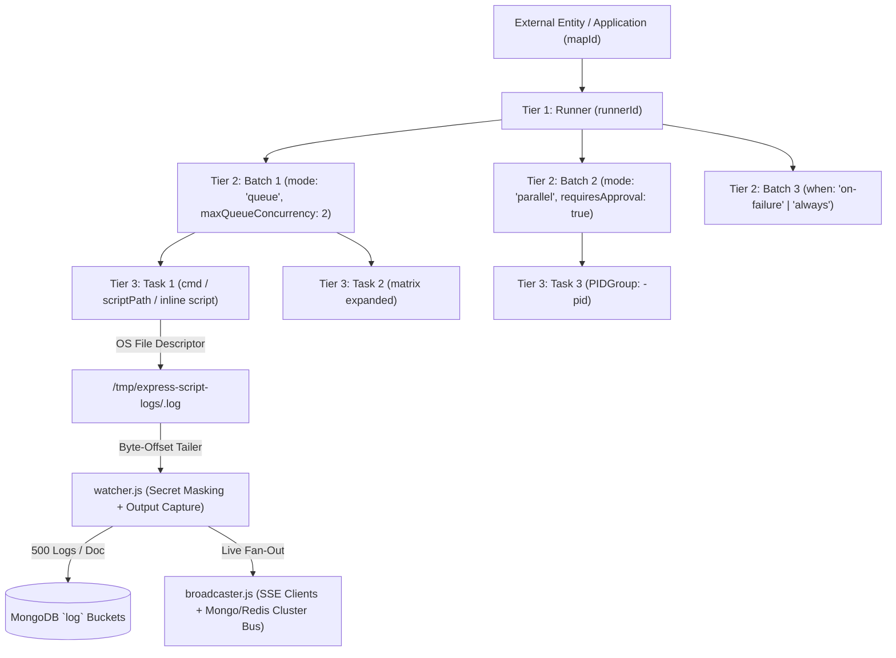

# Express Hierarchical Script Runner & Real-Time SSE Log Streamer

A production-grade, zero-dependency, **strictly functional** (`exports.fn = ...`, zero ES6 classes) **3-Tier Hierarchical Shell Script Orchestrator & Real-Time Server-Sent Events (SSE) Log Streaming Engine** for **Node.js, Express, and MongoDB / Mongoose**.

Designed as an embeddable CI/CD and deployment automation engine, it executes OS commands, external `.sh` scripts, and multi-line inline scripts across a 3-tier hierarchy (**Runner → Batch → Task**) with detached process-tree lifecycle management (`SIGSTOP`, `SIGCONT`, `SIGTERM`, `SIGKILL`), crash-safe disk-buffered log tailing, 500-entry MongoDB log bucketing, and dual-mode horizontal cluster scaling (**MongoDB-Native Cluster Mode by default**, with a runtime switch for **Redis Pub/Sub**).

---

## Table of Contents

1. [Core Architecture & Key Capabilities](#1-core-architecture--key-capabilities)
2. [3-Tier Hierarchy & Data Flow](#2-3-tier-hierarchy--data-flow)
3. [Project Structure](#3-project-structure)
4. [Quick Start: Express + MongoDB Integration](#4-quick-start-express--mongodb-integration)
5. [Comprehensive Use Cases & How-To Guide](#5-comprehensive-use-cases--how-to-guide)
   - [Use Case 1: Simple Single-Stage Command Execution](#use-case-1-simple-single-stage-command-execution)
   - [Use Case 2: Multi-Stage Sequential (`queue`) & Parallel (`parallel`) Batches](#use-case-2-multi-stage-sequential-queue--parallel-parallel-batches)
   - [Use Case 3: Executing External `.sh` Script Files & Multi-Line Inline Scripts](#use-case-3-executing-external-sh-script-files--multi-line-inline-scripts)
   - [Use Case 4: Structured CI/CD Log Headers & Real-Time Progress Parsing](#use-case-4-structured-cicd-log-headers--real-time-progress-parsing)
   - [Use Case 5: Inter-Task Output Variable Passing (`##[set-output KEY=VAL]`)](#use-case-5-inter-task-output-variable-passing-set-output-keyval)
   - [Use Case 6: Automatic Secret & Credential Redaction](#use-case-6-automatic-secret--credential-redaction)
   - [Use Case 7: Automatic Task Retries with Exponential Backoff](#use-case-7-automatic-task-retries-with-exponential-backoff)
   - [Use Case 8: Conditional Execution (`when` Rules on Batches & Tasks)](#use-case-8-conditional-execution-when-rules-on-batches--tasks)
   - [Use Case 9: Manual Approval Gates (`requiresApproval`, `approveBatch`, `rejectBatch`)](#use-case-9-manual-approval-gates-requiresapproval-approvebatch-rejectbatch)
   - [Use Case 10: Matrix Task Expansion (Cartesian Product Strategy)](#use-case-10-matrix-task-expansion-cartesian-product-strategy)
   - [Use Case 11: Delayed & Scheduled Triggers (`delayMs` & `runAt`)](#use-case-11-delayed--scheduled-triggers-delayms--runat)
   - [Use Case 12: Per-Application (`mapId`) Concurrency & Locking Policies](#use-case-12-per-application-mapid-concurrency--locking-policies)
   - [Use Case 13: Granular OS Process & Pipeline Controls (`skip`, `pause`, `resume`, `stop`)](#use-case-13-granular-os-process--pipeline-controls-skip-pause-resume-stop)
   - [Use Case 14: Fine-Grained Replay (`replayTask`, `replayBatch`, `replayRunner` Full & `fromFailed`)](#use-case-14-fine-grained-replay-replaytask-replaybatch-replayrunner-full--fromfailed)
   - [Use Case 15: Real-Time SSE Streaming & Seamless Browser Page Refresh / Reconnect](#use-case-15-real-time-sse-streaming--seamless-browser-page-refresh--reconnect)
   - [Use Case 16: Paginated, Filtered & Searchable Historical Log Queries (`queryLogs`)](#use-case-16-paginated-filtered--searchable-historical-log-queries-querylogs)
   - [Use Case 17: Downloadable Raw Build Log Export (`txt`, `ndjson`, `json`)](#use-case-17-downloadable-raw-build-log-export-txt-ndjson-json)
   - [Use Case 18: Pipeline Telemetry & Bottleneck Analytics (`getRunnerMetrics`)](#use-case-18-pipeline-telemetry--bottleneck-analytics-getrunnermetrics)
   - [Use Case 19: HMAC-Signed Outbound Webhooks & Lifecycle Hooks](#use-case-19-hmac-signed-outbound-webhooks--lifecycle-hooks)
   - [Use Case 20: Temp File Garbage Collection & MongoDB Log TTL Auto-Purge](#use-case-20-temp-file-garbage-collection--mongodb-log-ttl-auto-purge)
   - [Use Case 21: Multi-Node Cluster Mode A — Zero-Dependency MongoDB-Native (`useRedis: false` Default)](#use-case-21-multi-node-cluster-mode-a--zero-dependency-mongodb-native-useredis-false-default)
   - [Use Case 22: Multi-Node Cluster Mode B — Redis Pub/Sub (`useRedis: true` Switch Flag)](#use-case-22-multi-node-cluster-mode-b--redis-pubsub-useredis-true-switch-flag)
   - [Use Case 23: Crash Recovery & Orphan Process Reconciliation on Boot](#use-case-23-crash-recovery--orphan-process-reconciliation-on-boot)
6. [Plain React JS & Plain CSS Frontend Template Suite (`frontend/`)](#6-plain-react-js--plain-css-frontend-template-suite-frontend)
7. [Complete REST API & SSE Endpoints Reference](#7-complete-rest-api--sse-endpoints-reference)
8. [MongoDB Collections, Schemas & Index Architecture](#8-mongodb-collections-schemas--index-architecture)
9. [Constants & Status Enums Reference](#9-constants--status-enums-reference)
10. [Running the Test Suite](#10-running-the-test-suite)

---

## 1. Core Architecture & Key Capabilities

* **Strictly Functional Codebase**: 100% plain utility functions (`exports.fn = ...`). Zero ES6 `class`, `constructor`, `this`, or `new` keywords across the entire library.
* **3-Tier Execution Hierarchy**:
  * **Tier 1 — Runner (`runner`)**: Top-level pipeline linked to your application's reference ID (`mapId`) and user session (`ud: { uId, aId }`).
  * **Tier 2 — Batch (`batch`)**: Stage grouping tasks in either **Queue Mode** (sequential FIFO with configurable `maxQueueConcurrency`) or **Parallel Mode** (`Promise.all`).
  * **Tier 3 — Task (`task`)**: Individual command, `.sh` script file, or inline bash script spawned in an isolated OS process group (`detached: true`).
* **Crash-Safe Disk-Buffered Log Tailing**:
  * Child `stdout` and `stderr` write directly via OS file descriptors to `/tmp/express-script-logs/<taskId>.log`.
  * A non-blocking watcher tails the file from `task.byteOffset`. If your Node.js process restarts mid-deployment, the child process keeps running and `resumeRunningJobsOnBoot` re-attaches from the exact byte offset without losing a single log line.
* **MongoDB Bucketed Log Storage (`BUCKET_SIZE = 500`)**:
  * Logs are grouped into documents of up to `500` entries in the `log` collection.
  * Automatically slices chunks larger than `500` lines and handles concurrent `$push` race conditions when a bucket fills up.
* **Dual Multi-Node Cluster Engine**:
  * **Default (`useRedis: false`)**: Uses **MongoDB-Native Cluster Mode** (`clusterMode: 'mongo'`) with watermark delta tailing and DB-backed cross-node process control delegation (`pause-requested`, `resume-requested`, `stop-requested`).
  * **Optional (`useRedis: true`)**: Switches to **Redis Pub/Sub** (`clusterMode: 'redis'`) for sub-millisecond cross-node SSE fan-out and instant control signaling.

---

## 2. 3-Tier Hierarchy & Data Flow



---

## 3. Project Structure

| File | Responsibility |
| :--- | :--- |
| [`constants.js`](file:///Users/30057943/Documents/workspace/personal/devops/constants.js) | Constants (`BUCKET_SIZE`, `COLLECTIONS`, `EVENT_TYPES`, `RUNNER_STATUS`, `BATCH_STATUS`, `TASK_STATUS`, `WHEN_CONDITIONS`, `CLUSTER_MODES`), `/tmp` file helpers, ID/collection resolvers |
| [`process.js`](file:///Users/30057943/Documents/workspace/personal/devops/process.js) | Shell escaping, `.sh` & inline script preparation, detached process spawning (`detached: true`), process-tree signals (`SIGSTOP`, `SIGCONT`, `SIGTERM` → `SIGKILL`) |
| [`logger.js`](file:///Users/30057943/Documents/workspace/personal/devops/logger.js) | Session attribution (`user(req)`), secret extraction & masking, CI/CD `##[...]` log parser, and 500-entry MongoDB bucket writer (`appendLogsToDb`) |
| [`broadcaster.js`](file:///Users/30057943/Documents/workspace/personal/devops/broadcaster.js) | Real-time SSE connection manager (`attachStream`), history replay (`replayStreamHistory`), and Dual Cluster Engine (`mongo` delta tailer vs. `redis` Pub/Sub) |
| [`watcher.js`](file:///Users/30057943/Documents/workspace/personal/devops/watcher.js) | Byte-offset file tailer (`flushFileToDb`), timeout watchdog, cross-node `controlState` reconciler, `##[set-output]` capture, and `durationMs` computation |
| [`scheduler.js`](file:///Users/30057943/Documents/workspace/personal/devops/scheduler.js) | 3-Tier orchestrator (`triggerRunner`, `executeRunner`, `runBatch`, `executeTask`), `when` evaluator, `matrix` expander, manual approval gates, telemetry (`getRunnerMetrics`), and universal controls (`skip`, `stop`, `pause`, `resume`, `replay`) |
| [`schemas.js`](file:///Users/30057943/Documents/workspace/personal/devops/schemas.js) | Mongoose schemas & models, native MongoDB `$jsonSchema` validators, compound/TTL index provisioning (`ensureSchemasAndIndexes`), and document builders |
| [`routes.js`](file:///Users/30057943/Documents/workspace/personal/devops/routes.js) | Express route handlers and 1-line router mounting (`registerRoutes`) |
| [`index.js`](file:///Users/30057943/Documents/workspace/personal/devops/index.js) | Unified public API exports, `queryLogs`, and `exportRunnerLogs` |
| [`frontend/DevOpsRunnerDashboard.jsx`](file:///Users/30057943/Documents/workspace/personal/devops/frontend/DevOpsRunnerDashboard.jsx) | Plain React JS dashboard & 9 modular sub-components covering all 23+ use cases |
| [`frontend/DevOpsRunnerDashboard.css`](file:///Users/30057943/Documents/workspace/personal/devops/frontend/DevOpsRunnerDashboard.css) | Pure dependency-free CSS stylesheet for the 3-tier tree, live SSE terminal, badges, and waterfall analytics |
| [`frontend/apiClient.js`](file:///Users/30057943/Documents/workspace/personal/devops/frontend/apiClient.js) | Plain JS `fetch` & `EventSource` client wrapping all REST and SSE endpoints |
| [`frontend/useCaseTemplates.js`](file:///Users/30057943/Documents/workspace/personal/devops/frontend/useCaseTemplates.js) | Complete catalog of all 23+ Use Cases with ready-to-trigger pipeline payloads |
| [`frontend/index.html`](file:///Users/30057943/Documents/workspace/personal/devops/frontend/index.html) | Zero-build standalone browser preview with an interactive in-browser pipeline simulator |

---

## 4. Quick Start: Express + MongoDB Integration

```javascript
const express = require('express');
const { MongoClient } = require('mongodb');
const runnerLib = require('./index');

const app = express();
app.use(express.json());

// 1. Optional: Plug in your session utility so every Runner & Log Bucket records `ud: { uId, aId }`
runnerLib.setSessionProvider({
  details: (req) => ({
    uId: req.headers['x-user-id'] || 'user_101',
    aId: req.headers['x-account-id'] || 'acct_900'
  })
});

const startServer = async () => {
  const client = await MongoClient.connect(process.env.MONGO_URI || 'mongodb://127.0.0.1:27017');
  const db = client.db('devops_runner');

  // Attach `db` to `req.db` (or `app.locals.db`)
  app.use((req, _res, next) => {
    req.db = db;
    next();
  });

  // 2. Provision MongoDB $jsonSchema validators, compound indexes, and optional 30-day Log TTL
  await runnerLib.ensureSchemasAndIndexes({ db }, {
    logTtlSeconds: 30 * 24 * 3600 // Auto-expire log buckets after 30 days (optional)
  });

  // 3. Mount all REST & SSE endpoints under `/api/devops`
  const apiRouter = express.Router();
  runnerLib.registerRoutes(apiRouter);
  app.use('/api/devops', apiRouter);

  // 4. Re-attach to any surviving detached OS processes or mark dead orphans as failed on boot
  await runnerLib.resumeRunningJobsOnBoot({ db });

  app.listen(3000, () => {
    console.log('DevOps Script Runner listening on http://localhost:3000');
  });
};

startServer();
```

---

## 5. Comprehensive Use Cases & How-To Guide

Below is every supported use case with both **Programmatic Node.js API** and **REST / HTTP** examples.

---

### Use Case 1: Simple Single-Stage Command Execution

When you only need to run an array of shell commands without defining explicit batches, pass `tasks` directly to `triggerRunner`. It automatically creates a default sequential batch.

```javascript
const result = await runnerLib.triggerRunner(req, {
  mapId: 'project-alpha',        // Links this run to your application/deployment ID
  awaitCompletion: true,         // Wait for pipeline to finish before resolving (default: false)
  tasks: [
    'echo "Step 1: Checking Node version" && node -v',
    'echo "Step 2: Running linter"',
    'echo "Step 3: Build complete"'
  ]
});

console.log(result.runnerId);    // e.g. "6727a9..."
console.log(result.status);      // "completed"
```

**Via REST API:**
```bash
curl -X POST http://localhost:3000/api/devops/maps/project-alpha/runners \
  -H "Content-Type: application/json" \
  -d '{
    "tasks": [
      "echo \"Starting build\"",
      "npm run build"
    ]
  }'
```

---

### Use Case 2: Multi-Stage Sequential (`queue`) & Parallel (`parallel`) Batches

Organize complex pipelines into ordered stages (`batches`). Each batch can run in:
* **`mode: 'queue'`** (FIFO sequential, or bounded worker pool via `maxQueueConcurrency: N`)
* **`mode: 'parallel'`** (all tasks in the batch execute simultaneously via `Promise.all`)

```javascript
const result = await runnerLib.triggerRunner(req, {
  mapId: 'microservice-deploy-42',
  batches: [
    {
      name: 'Stage 1: Install & Compile (Sequential)',
      mode: runnerLib.BATCH_MODES.QUEUE,
      maxQueueConcurrency: 1, // Strict 1-by-1 execution
      tasks: [
        { name: 'Install Deps', cmd: 'npm ci' },
        { name: 'Compile TypeScript', cmd: 'npm run build' }
      ]
    },
    {
      name: 'Stage 2: Quality Checks (Parallel)',
      mode: runnerLib.BATCH_MODES.PARALLEL, // Runs Unit Tests, Lint, and Security Audit at the same time
      tasks: [
        { name: 'Unit Tests', cmd: 'npm run test:unit' },
        { name: 'ESLint Check', cmd: 'npm run lint' },
        { name: 'Security Audit', cmd: 'npm audit --audit-level=high' }
      ]
    },
    {
      name: 'Stage 3: Bounded Rolling Restart (2 Workers at a time)',
      mode: runnerLib.BATCH_MODES.QUEUE,
      maxQueueConcurrency: 2, // Runs 2 tasks concurrently out of the 4 queued tasks
      continueOnError: false, // Stop batch if any task fails
      tasks: [
        { name: 'Restart Pod 1', cmd: './scripts/restart-pod.sh pod-1' },
        { name: 'Restart Pod 2', cmd: './scripts/restart-pod.sh pod-2' },
        { name: 'Restart Pod 3', cmd: './scripts/restart-pod.sh pod-3' },
        { name: 'Restart Pod 4', cmd: './scripts/restart-pod.sh pod-4' }
      ]
    }
  ]
});
```

---

### Use Case 3: Executing External `.sh` Script Files & Multi-Line Inline Scripts

Tasks support three execution styles with safe POSIX shell argument escaping, custom `cwd`, custom `shell` (`/bin/bash`, `/bin/zsh`, `/bin/sh`), and merged `env` variables (Runner `env` → Batch `env` → Task `env`):

1. **`cmd`**: Direct shell command string.
2. **`scriptPath` (or `file`) + `args`**: Executes an existing `.sh` file on disk with escaped arguments.
3. **`script` (or `inlineScript`) + `args`**: Writes a multi-line script to `/tmp/express-script-logs/<taskId>.sh` (`0o700` permissions) and executes it.

```javascript
const result = await runnerLib.triggerRunner(req, {
  mapId: 'shell-modes-demo',
  cwd: '/srv/deployments',
  shell: '/bin/bash',
  env: { GLOBAL_REGION: 'ap-south-1' },
  batches: [
    {
      name: 'Mixed Script Execution',
      env: { STAGE_TIER: 'production' },
      tasks: [
        // Mode A: External .sh file with safely escaped arguments
        {
          name: 'Run Provisioning Script',
          scriptPath: '/srv/deployments/provision.sh',
          args: ['--cluster', 'prod main cluster', '--replicas=3'],
          env: { NODE_ENV: 'production' }
        },
        // Mode B: Multi-line inline bash script with `set -euo pipefail`
        {
          name: 'Inline Health Check Script',
          script: [
            '#!/usr/bin/env bash',
            'set -euo pipefail',
            'echo "Region: $GLOBAL_REGION | Tier: $STAGE_TIER | Arg1: $1"',
            'for i in 1 2 3; do',
            '  echo "Health ping $i OK"',
            'done'
          ].join('\n'),
          args: ['https://api.example.com/healthz']
        }
      ]
    }
  ]
});
```

---

### Use Case 4: Structured CI/CD Log Headers & Real-Time Progress Parsing

Any command or `.sh` script can emit GitHub Actions / Azure DevOps-style `##[...]` annotations to `stdout` or `stderr`. [`parseLogLine`](file:///Users/30057943/Documents/workspace/personal/devops/logger.js#L157-L227) automatically converts them into typed events and extracts numeric `progress` percentages (`0–100`) for frontend progress bars:

| Script Output Line | Parsed `type` | Extracted Metadata |
| :--- | :--- | :--- |
| `echo "##[step-start] Building Docker Image"` | `step-start` | `msg: "Building Docker Image"` |
| `echo "##[progress 65%] Uploading layers"` | `progress` | `progress: 65`, `msg: "Uploading layers"` |
| `echo "##[warning] Deprecated package found"` | `warning` | `msg: "Deprecated package found"` |
| `echo "##[error] Connection timed out"` | `error` | `msg: "Connection timed out"` |
| `echo "##[step-ok] Image pushed"` | `step-ok` | `msg: "Image pushed"` |
| `echo "##[step-fail] Smoke test failed"` | `step-fail` | `msg: "Smoke test failed"` |
| `echo "##[section-start] Terraform Plan"` | `section-start` | Collapsible UI log group start |
| `echo "##[section-end] Terraform Plan"` | `section-end` | Collapsible UI log group end |
| `echo "##[set-output IMAGE_TAG=v2.4.1]"` | `output` | `outputKey: "IMAGE_TAG"`, `outputValue: "v2.4.1"` |

---

### Use Case 5: Inter-Task Output Variable Passing (`##[set-output KEY=VAL]`)

Tasks can dynamically pass variables (such as build tags, artifact URLs, or commit SHAs) to downstream tasks and batches by printing `##[set-output KEY=VALUE]`:

1. [`flushFileToDb`](file:///Users/30057943/Documents/workspace/personal/devops/watcher.js#L114-L148) captures `KEY=VALUE` and persists it on `task.outputs` and `runner.outputs`.
2. Every subsequent task automatically receives all accumulated `runner.outputs` injected into its process `env`!

```javascript
const run = await runnerLib.triggerRunner(req, {
  mapId: 'artifact-promotion-pipeline',
  awaitCompletion: true,
  batches: [
    {
      name: 'Stage 1: Build Artifact',
      tasks: [
        {
          name: 'Generate Release Version',
          cmd: 'echo "##[set-output RELEASE_TAG=v1.9.0-rc2]" && echo "##[set-output ARTIFACT_PATH=/tmp/app.tar.gz]"'
        }
      ]
    },
    {
      name: 'Stage 2: Deploy Artifact',
      tasks: [
        {
          name: 'Deploy Using Upstream Outputs',
          // $RELEASE_TAG and $ARTIFACT_PATH are automatically available in process.env!
          cmd: 'echo "Deploying tag $RELEASE_TAG from $ARTIFACT_PATH"'
        }
      ]
    }
  ]
});

console.log(run.runner.outputs);
// { RELEASE_TAG: 'v1.9.0-rc2', ARTIFACT_PATH: '/tmp/app.tar.gz' }
```

---

### Use Case 6: Automatic Secret & Credential Redaction

Prevent accidental credential leaks in MongoDB log buckets and live SSE streams:
* Any `env` variable whose key matches `/PASSWORD|PASSWD|SECRET|TOKEN|API_KEY|PRIVATE_KEY|ACCESS_KEY|AUTH|CREDENTIAL/i` is **automatically redacted** as `***REDACTED***`.
* You can also pass explicit `secretKeys` (additional env var names) or `secrets` (raw secret strings) at the Runner or Task level.

```javascript
await runnerLib.triggerRunner(req, {
  mapId: 'secure-deploy',
  env: {
    AWS_SECRET_ACCESS_KEY: 'wJalrXUtnFEMI/K7MDENG/bPxRfiCYEXAMPLEKEY',
    DB_PASSWORD: 'super-secret-prod-password',
    INTERNAL_VAULT_VAL: 'custom-sensitive-string'
  },
  secretKeys: ['INTERNAL_VAULT_VAL'],       // Custom env key to redact
  secrets: ['my-raw-bearer-token-999'],     // Raw literal string to redact
  tasks: [
    // Even if a script echoes secrets, they are masked before hitting MongoDB or SSE!
    'echo "Connecting with $DB_PASSWORD and $INTERNAL_VAULT_VAL and my-raw-bearer-token-999"'
  ]
});
// Persisted & streamed log line:
// "Connecting with ***REDACTED*** and ***REDACTED*** and ***REDACTED***"
```

---

### Use Case 7: Automatic Task Retries with Exponential Backoff

Handle transient network glitches (`npm install`, `docker pull`, `curl`) without failing the entire pipeline by configuring `maxRetries`, `retryDelayMs`, and `retryBackoffFactor` at the Runner, Batch, or Task level:

$$\text{Delay}_{\text{attempt}} = \text{retryDelayMs} \times \left(\text{retryBackoffFactor}\right)^{\text{attempt} - 1}$$

```javascript
const run = await runnerLib.triggerRunner(req, {
  mapId: 'flaky-network-job',
  awaitCompletion: true,
  tasks: [
    {
      name: 'Push Container Image',
      cmd: './scripts/push-image.sh',
      maxRetries: 3,            // Retry up to 3 times after initial failure (4 total attempts)
      retryDelayMs: 1000,       // 1s before retry #1, 2s before retry #2, 4s before retry #3
      retryBackoffFactor: 2
    }
  ]
});
```

---

### Use Case 8: Conditional Execution (`when` Rules on Batches & Tasks)

Configure `when` rules on any **Batch** or **Task** to build self-healing rollback pipelines, guaranteed teardown stages, or output-driven branching:

* **`when: 'on-success'`** (default): Runs only if no prior batch/task has failed.
* **`when: 'on-failure'`**: Runs **only** when an upstream batch or task has failed (ideal for rollback scripts or Slack/PagerDuty failure alerts).
* **`when: 'always'`**: Runs **unconditionally** whether upstream stages succeeded or failed (ideal for cleaning up ephemeral Docker containers or temporary environments).
* **`when: { status, output, notOutput, env }`**: Declarative rule matching `runner.outputs` or `task.env`.
* **`when: (ctx) => boolean`**: Custom JavaScript predicate function receiving `{ hasFailed, outputs, env, runner, batch }`.

```javascript
const run = await runnerLib.triggerRunner(req, {
  mapId: 'canary-with-auto-rollback',
  awaitCompletion: true,
  batches: [
    {
      name: '1. Pre-Flight Check',
      tasks: [
        'echo "##[set-output DEPLOY_TARGET=production]" && echo "##[set-output RUN_DB_MIGRATION=false]"'
      ]
    },
    {
      name: '2. Database Migration (Conditional on Output)',
      when: { output: { RUN_DB_MIGRATION: 'true' } }, // Automatically SKIPPED because RUN_DB_MIGRATION is 'false'
      tasks: ['npm run db:migrate']
    },
    {
      name: '3. Production Rollout',
      when: { status: 'on-success', output: { DEPLOY_TARGET: 'production' } },
      tasks: [
        { name: 'Deploy New Release', cmd: './scripts/deploy-prod.sh' },
        { name: 'Task-Level Failure Alert', when: 'on-failure', cmd: './scripts/notify-oncall.sh' }
      ]
    },
    {
      name: '4. Automated Rollback (Only on Failure)',
      when: 'on-failure', // Executes ONLY if Stage 3 failed!
      tasks: [
        'echo "##[warning] Rollout failed! Reverting to previous stable release..."',
        './scripts/rollback-prod.sh'
      ]
    },
    {
      name: '5. Teardown Temp Bastion Tunnel (Always Runs)',
      when: 'always', // Executes whether Stage 3 succeeded OR failed
      tasks: ['./scripts/close-bastion-tunnel.sh']
    }
  ]
});
```

---

### Use Case 9: Manual Approval Gates & Complete `APPROVAL_STATUS` Lifecycle (`requiresApproval`, `approveBatch`, `rejectBatch`, `skipBatch`, `expireBatchApproval`)

Pause a pipeline before sensitive stages (e.g., Production Deployment or Terraform Apply) without holding OS child processes open, with full lifecycle state tracking via `APPROVAL_STATUS`:

| Enum Key (`APPROVAL_STATUS`) | Value | When It Occurs |
| :--- | :--- | :--- |
| `APPROVAL_STATUS.NONE` | `null` | **(Default)** Batch does not require manual approval (`requiresApproval: false`). |
| `APPROVAL_STATUS.PENDING` | `'pending'` | Batch has `requiresApproval: true` and is waiting for approval (either `queued` upstream or currently paused at `status: 'awaiting-approval'`). |
| `APPROVAL_STATUS.APPROVED` | `'approved'` | Approved via [`approveBatch`](file:///Users/30057943/Documents/workspace/personal/devops/scheduler.js#L3169-L3298) or [`approveBatches`](file:///Users/30057943/Documents/workspace/personal/devops/scheduler.js#L3407-L3425) (supports **Gate Approval**, **Pre-Approval** while `queued`, and **Re-Approval** after `rejected`/`expired`/`cancelled`/`skipped`). |
| `APPROVAL_STATUS.REJECTED` | `'rejected'` | Explicitly rejected via [`rejectBatch`](file:///Users/30057943/Documents/workspace/personal/devops/scheduler.js#L3300-L3353) or [`rejectBatches`](file:///Users/30057943/Documents/workspace/personal/devops/scheduler.js#L3427-L3445) (preserved even after `stopRunner` halts the pipeline). |
| `APPROVAL_STATUS.SKIPPED` | `'skipped'` | Approval gate bypassed via [`skipBatch`](file:///Users/30057943/Documents/workspace/personal/devops/scheduler.js#L2117-L2220) or automatically bypassed when a batch's `when` condition evaluates to `false`. |
| `APPROVAL_STATUS.CANCELLED` | `'cancelled'` | Pipeline or batch was stopped via [`stopRunner`](file:///Users/30057943/Documents/workspace/personal/devops/scheduler.js#L2446-L2531) or [`stopBatch`](file:///Users/30057943/Documents/workspace/personal/devops/scheduler.js#L2381-L2444) while the approval gate was still `'pending'` / `'awaiting-approval'`. |
| `APPROVAL_STATUS.EXPIRED` | `'expired'` | Approval gate timed out when `approvalTimeoutMs` elapsed without a decision, or manually expired via [`expireBatchApproval`](file:///Users/30057943/Documents/workspace/personal/devops/scheduler.js#L3355-L3405). |

```javascript
// 1. Trigger pipeline with an approval gate + optional SLA timeout (approvalTimeoutMs)
const pipeline = await runnerLib.triggerRunner(req, {
  mapId: 'prod-release-v3',
  batches: [
    {
      name: 'Stage 1: Deploy to Staging & Run E2E',
      tasks: ['./scripts/deploy-staging.sh', './scripts/run-e2e.sh']
    },
    {
      _id: 'batch_prod_gate_01',
      name: 'Stage 2: Production Cutover (Requires Release Manager Approval)',
      requiresApproval: true,
      approvalTimeoutMs: 3600000, // Optional 1-hour approval SLA timer -> 'expired'
      tasks: ['./scripts/deploy-production.sh']
    }
  ]
});

// 2. Discover runners & batches waiting for approval
const awaitingRunners = await runnerLib.getAwaitingApprovalRunners(req, { mapId: 'prod-release-v3' });
const awaitingBatches = await runnerLib.getAwaitingApprovalBatches(req, { runnerId: pipeline.runnerId });
const allPendingGates = await runnerLib.getPendingApprovalBatches(req, { runnerId: pipeline.runnerId }); // includes queued pre-approvable gates

// 3A. Approve at Gate, Pre-Approve while 'queued', or Re-Approve after 'rejected'/'expired'/'cancelled'
await runnerLib.approveBatch(req, 'batch_prod_gate_01', {
  approvedBy: 'alice@company.com',
  comment: 'Staging E2E verified, approved for production rollout',
  awaitCompletion: true
});

// 3B. Or Reject the Batch (sets approvalStatus: 'rejected' and stops the parent runner)
await runnerLib.rejectBatch(req, 'batch_prod_gate_01', {
  rejectedBy: 'security@company.com',
  reason: 'Blocked due to pending CVE patch'
});

// 3C. Or Skip the Gate (sets approvalStatus: 'skipped' and continues downstream batches)
await runnerLib.skipBatch(req, 'batch_prod_gate_01');

// 3D. Or Expire the Gate / Bulk Approve / Bulk Reject
await runnerLib.expireBatchApproval(req, 'batch_prod_gate_01', { reason: 'Change window closed' });
await runnerLib.approveBatches(req, { runnerId: pipeline.runnerId, approvedBy: 'alice@company.com' });
await runnerLib.rejectBatches(req, { runnerId: pipeline.runnerId, rejectedBy: 'secops@company.com' });
```

**Via REST API:**
```bash
# Discover runners & batches awaiting approval
curl "http://localhost:3000/api/devops/runners/awaiting-approval?mapId=prod-release-v3"
curl "http://localhost:3000/api/devops/batches/awaiting-approval?runnerId=6727a9..."
curl "http://localhost:3000/api/devops/batches/pending-approval?runnerId=6727a9..."

# Approve a gated batch (also supports pre-approval on queued batches & re-approval after rejection/expiry)
curl -X POST http://localhost:3000/api/devops/batches/batch_prod_gate_01/approve \
  -H "Content-Type: application/json" \
  -d '{ "approvedBy": "alice@company.com", "comment": "Approved for prod" }'

# Reject a gated batch
curl -X POST http://localhost:3000/api/devops/batches/batch_prod_gate_01/reject \
  -H "Content-Type: application/json" \
  -d '{ "rejectedBy": "secops@company.com", "reason": "CVE-2026-1234" }'

# Expire a gated batch or Bulk Approve / Bulk Reject
curl -X POST http://localhost:3000/api/devops/batches/batch_prod_gate_01/expire-approval \
  -H "Content-Type: application/json" \
  -d '{ "reason": "Approval window expired" }'
curl -X POST http://localhost:3000/api/devops/batches/approve \
  -H "Content-Type: application/json" \
  -d '{ "runnerId": "6727a9...", "approvedBy": "alice@company.com" }'
```

---

### Use Case 10: Matrix Task Expansion (Cartesian Product Strategy)

Run the same task template across multiple dimensions (e.g., `REGION × SERVICE` or `OS × NODE_VERSION`) using `matrix` on a Batch or individual Task. [`expandMatrixTasks`](file:///Users/30057943/Documents/workspace/personal/devops/scheduler.js#L303-L354) automatically generates the Cartesian product, appends `[KEY=VAL, ...]` to each task name, stores `matrixValues` on each task document, and injects each combination into `task.env`:

```javascript
const matrixRun = await runnerLib.triggerRunner(req, {
  mapId: 'multi-region-rollout',
  awaitCompletion: true,
  batches: [
    {
      name: 'Parallel Multi-Region Service Rollout',
      mode: runnerLib.BATCH_MODES.PARALLEL,
      matrix: {
        REGION: ['us-east-1', 'eu-west-1', 'ap-south-1'],
        SERVICE: ['api-gateway', 'auth-worker']
      },
      tasks: [
        {
          name: 'Deploy Service',
          // Expands into 3 x 2 = 6 parallel tasks with $REGION and $SERVICE injected into env!
          cmd: 'echo "Deploying $SERVICE to $REGION" && ./deploy.sh --region "$REGION" --service "$SERVICE"'
        }
      ]
    }
  ]
});

console.log(matrixRun.tasks.map((t) => t.name));
// [
//   "Deploy Service [REGION=us-east-1, SERVICE=api-gateway]",
//   "Deploy Service [REGION=us-east-1, SERVICE=auth-worker]",
//   "Deploy Service [REGION=eu-west-1, SERVICE=api-gateway]",
//   "Deploy Service [REGION=eu-west-1, SERVICE=auth-worker]",
//   "Deploy Service [REGION=ap-south-1, SERVICE=api-gateway]",
//   "Deploy Service [REGION=ap-south-1, SERVICE=auth-worker]"
// ]
```

---

### Use Case 11: Delayed & Scheduled Triggers (`delayMs` & `runAt`)

Schedule a pipeline to start after a delay (`delayMs`) or at a specific future timestamp (`runAt` ISO string or epoch ms):
* The runner is created immediately in `status: 'scheduled'` (`RUNNER_STATUS.SCHEDULED`) with `scheduledAt` persisted.
* Use [`getScheduledRunners(req, options)`](file:///Users/30057943/Documents/workspace/personal/devops/scheduler.js#L244-L250) (`GET /runners/scheduled`) to list all pending delayed/scheduled runs (including `hasActiveTimer`).
* Call [`stopRunner(req, runnerId)`](file:///Users/30057943/Documents/workspace/personal/devops/scheduler.js#L2095-L2180) (`POST /runners/:runnerId/stop`) to cancel a single scheduled run before `scheduledAt` arrives, or [`cancelScheduledRunners(req, options)`](file:///Users/30057943/Documents/workspace/personal/devops/scheduler.js#L270-L283) (`POST /runners/scheduled/cancel`) to bulk-cancel all scheduled runs.

```javascript
// Option A: Start after a 60-second cool-down window
const delayedRun = await runnerLib.triggerRunner(req, {
  mapId: 'scheduled-maintenance',
  delayMs: 60000,
  tasks: ['./scripts/run-maintenance.sh']
});
console.log(delayedRun.status); // "scheduled"

// List all pending delayed/scheduled runners (with hasActiveTimer flag):
const pendingRuns = await runnerLib.getScheduledRunners(req, { mapId: 'scheduled-maintenance' });

// Cancel a single scheduled runner before it starts:
await runnerLib.stopRunner(req, delayedRun.runnerId);

// Or bulk-cancel ALL scheduled runners for a mapId (or globally):
await runnerLib.cancelScheduledRunners(req, { mapId: 'scheduled-maintenance' });

// Option B: Start at an exact future timestamp
const nightlyRun = await runnerLib.triggerRunner(req, {
  mapId: 'nightly-backup',
  runAt: '2026-11-04T02:00:00.000Z',
  tasks: ['./scripts/db-backup.sh']
});
```

---

### Use Case 12: Per-Application (`mapId`) Concurrency & Locking Policies

Prevent two engineers from deploying the same application (`mapId`) at the same time using `concurrencyPolicy`:

| Policy Constant | Value | Behavior when `mapId` already has an active Runner |
| :--- | :--- | :--- |
| `CONCURRENCY_POLICIES.ALLOW` | `'allow'` | **(Default)** Allows multiple runners for the same `mapId` in parallel. |
| `CONCURRENCY_POLICIES.REJECT` | `'reject'` | Throws `409 Conflict` (`err.code = 'RUNNER_CONFLICT'`, `err.activeRunnerIds`). |
| `CONCURRENCY_POLICIES.CANCEL_PREVIOUS` | `'cancel-previous'` | Automatically stops and kills all active runners on `mapId` before starting the new run (ideal for PR commits). |
| `CONCURRENCY_POLICIES.QUEUE` | `'queue'` | Waits for the currently active runner on `mapId` to finish before starting the new run. |

```javascript
// Reject concurrent deployments to the same production environment
try {
  await runnerLib.triggerRunner(req, {
    mapId: 'prod-payment-service',
    concurrencyPolicy: runnerLib.CONCURRENCY_POLICIES.REJECT,
    tasks: ['./deploy.sh']
  });
} catch (err) {
  if (err.code === 'RUNNER_CONFLICT') {
    console.error('Deployment already in progress:', err.activeRunnerIds);
  }
}
```

---

### Use Case 13: Granular OS Process & Pipeline Controls + 3-Tier Discovery (`skip`, `pause`, `resume`, `stop`)

Discover and control execution at **any tier** (Task, Batch, or Runner), both individually and in bulk:

* **Skip (`skipTask`, `skipBatch`, `skipBatches`)**:
  * Marks a `queued`, `paused`, or `waiting_approval` batch (and its non-finished tasks) as `skipped`.
  * If `skipBatch` is called on a `waiting_approval` batch, it automatically transitions the parent runner back to `running` and resumes downstream batches.
  * Pass `{ force: true }` (`skipBatch(req, batchId, { force: true })`) to forcefully skip an actively running batch (killing active child processes and skipping remaining tasks).
* **Pause (`pauseTask`, `pauseTasks`, `pauseRunner`)**:
  * `pauseTask(req, taskId)` sends **`SIGSTOP` (`-pid`)** to the entire OS process group, immediately freezing CPU execution mid-command, and pauses the task timeout watchdog timer. Includes terminal-state guards so finished tasks are never overwritten.
  * `pauseRunner(req, runnerId)` sets `controlState: 'pause-requested'` so the runner pauses cleanly before the next task/batch.
* **Resume (`resumeTask`, `resumeTasks`, `resumeRunner`)**:
  * `resumeTask(req, taskId)` sends **`SIGCONT` (`-pid`)** to unfreeze the OS process group and resumes the remaining timeout watchdog budget.
  * `resumeRunner(req, runnerId)` resumes any paused tasks/batches and continues the pipeline loop.
* **Stop (`stopTask`, `stopBatch`, `stopRunner`, `stopRunners`)**:
  * Sends **`SIGTERM` (`-pid`)** to the process group, waits `killGraceMs` (default `3000ms`), and escalates to **`SIGKILL` (`-pid`)** if any child/grandchild process survives. Fires `notifyRunnerFinished` lifecycle hooks even when stopping a non-running (`scheduled`, `paused`, `waiting_approval`) runner.

```javascript
// 1. Discover targets across all 3 tiers
const runningTasks     = await runnerLib.getRunningTasks(req, { runnerId });
const pausedTasks      = await runnerLib.getPausedTasks(req, { runnerId });
const skippableBatches = await runnerLib.getSkippableBatches(req, { runnerId });
const pausedRunners    = await runnerLib.getPausedRunners(req, { mapId: 'prod-deploy' });

// 2. Single-item OS process & pipeline controls
await runnerLib.pauseTask(req, taskId);                    // SIGSTOP (-pid)
await runnerLib.resumeTask(req, taskId);                   // SIGCONT (-pid)
await runnerLib.skipBatch(req, batchId);                   // Skips queued, paused, or waiting_approval batch
await runnerLib.skipBatch(req, batchId, { force: true });  // Force-skips running batch
await runnerLib.stopRunner(req, runnerId);                 // Kills all active child process trees

// 3. Bulk controls across a runner, batch, or mapId
await runnerLib.pauseTasks(req, { runnerId });
await runnerLib.resumeTasks(req, { runnerId });
await runnerLib.skipBatches(req, { runnerId });
await runnerLib.stopRunners(req, { mapId: 'prod-deploy' });
```

---

### Use Case 14: Fine-Grained Replay (`replayTask`, `replayBatch`, `replayRunner` Full & `fromFailed`)

Discover failed items (`getFailedRunners`, `getFailedBatches`, `getFailedTasks`) and re-run failed or completed work **without creating a new `mapId` or losing pipeline context**:

1. **`replayTask(req, taskId)`**: Truncates the task's `/tmp` log file, resets `byteOffset: 0`, `retryCount: 0`, `status: 'queued'`, re-executes that single task, and automatically synchronizes parent Batch and Runner statuses via [`syncParentHierarchyStatus`](file:///Users/30057943/Documents/workspace/personal/devops/scheduler.js#L2457-L2519).
2. **`replayBatch(req, batchId, options)`**:
   * **Full Batch Replay**: Resets all tasks in the batch, truncates their `/tmp` log files, and re-runs the batch.
   * **`replayBatch(req, batchId, { fromFailed: true, fromTaskId })`**: Preserves all `done` tasks in the batch (`preservedTaskIds`), resets **only** failed/stopped/pending tasks (or from `fromTaskId` onward), re-runs them, and synchronizes parent Runner status!
3. **`replayRunner(req, runnerId)` (Full Replay)**: Resets all batches and tasks from index `0` (`retryCount: 0`) while **preserving the existing `runnerId` and `mapId`**.
4. **`replayRunner(req, runnerId, { fromFailed: true, fromBatchId, fromTaskId })` (Smart Resume Replay)**: Keeps all earlier `done` batches and tasks intact, resets **only** from the first failed/stopped batch or task onward, and runs the remainder of the pipeline!

```javascript
// 1. Discover failed items across all 3 tiers
const failedRunners = await runnerLib.getFailedRunners(req, { mapId: 'prod-deploy' });
const failedBatches = await runnerLib.getFailedBatches(req, { runnerId });
const failedTasks   = await runnerLib.getFailedTasks(req, { runnerId });

// 2. Replay a single failed task (auto-syncs parent Batch & Runner to completed if all tasks are now done!)
await runnerLib.replayTask(req, taskId);

// 3. Replay ONLY failed tasks within a Batch (preserving 'done' tasks in that batch)
await runnerLib.replayBatch(req, batchId, { fromFailed: true });

// 4. Replay Runner ONLY from the failed batch/task onward
await runnerLib.replayRunner(req, runnerId, {
  fromFailed: true,
  awaitCompletion: true
});

// 5. Or replay starting from a specific taskId or batchId
await runnerLib.replayRunner(req, runnerId, {
  fromTaskId: 'task_step_3',
  awaitCompletion: true
});
```

---

### Use Case 15: Real-Time SSE Streaming & Seamless Browser Page Refresh / Reconnect

Connect any browser or CLI client to a live Server-Sent Events stream filtered by `mapId`, `runnerId`, `batchId`, or `taskId`.

**Built-In Page Refresh & Reconnect Support**:
* **`?replayHistory=true`**: Automatically streams historical logs from MongoDB buckets first, then seamlessly transitions to live tailing without duplicates.
* **`?includeState=true`**: Emits an initial `event: state` JSON snapshot containing the current `{ runners, batches, tasks }` statuses so your UI can render the full pipeline tree immediately on page load.
* **`Last-Event-ID` header or `?afterTs=<epoch>`**: Resumes streaming strictly after the last timestamp the browser received before a network drop.

**Backend Route (mounted automatically by `registerRoutes`):**
```http
GET /api/devops/runners/:runnerId/stream?replayHistory=true&includeState=true
```

**Frontend Browser Example (`EventSource`):**
```javascript
const source = new EventSource(
  `/api/devops/runners/${runnerId}/stream?replayHistory=true&includeState=true`
);

// 1. Initial pipeline state snapshot on page load / refresh
source.addEventListener('state', (e) => {
  const { runners, batches, tasks } = JSON.parse(e.data);
  renderPipelineTree(runners, batches, tasks);
});

// 2. Real-time stdout / stderr / step-start / progress / status events
source.onmessage = (e) => {
  const payload = JSON.parse(e.data);
  // payload: { mapId, runnerId, batchId, taskId, type, msg, ts, progress }
  appendLogLineToTerminal(payload);
};

// 3. Dedicated typed event listeners (optional)
source.addEventListener('progress', (e) => {
  const { taskId, progress } = JSON.parse(e.data);
  updateTaskProgressBar(taskId, progress);
});
```

---

### Use Case 16: Paginated, Filtered & Searchable Historical Log Queries (`queryLogs`)

Query bucketed logs across any tier (`mapId`, `runnerId`, `batchId`, `taskId`) with type filtering, case-insensitive full-text search, time-window filtering (`afterTs`, `beforeTs`), and pagination (`limit`, `offset`):

```javascript
const errorReport = await runnerLib.queryLogs(req, {
  runnerId: '6727a9...',
  type: ['error', 'stderr', 'warning'], // Filter by single type or array/comma-list
  search: 'connection refused',         // Case-insensitive substring search
  afterTs: Date.now() - 3600_000,       // Last 1 hour
  limit: 100,
  offset: 0
});

console.log(errorReport.totalLogs);     // Total matching log lines
console.log(errorReport.hasMore);       // true if more pages exist
console.log(errorReport.logs);          // Array of flattened log entries
```

**Via REST API:**
```bash
GET /api/devops/runners/6727a9.../logs?type=error,warning&search=timeout&limit=50&offset=0
```

---

### Use Case 17: Downloadable Raw Build Log Export (`txt`, `ndjson`, `json`)

Export formatted build logs for compliance archiving, offline debugging, or "Download Raw Logs" UI buttons using [`exportRunnerLogs`](file:///Users/30057943/Documents/workspace/personal/devops/index.js#L221-L275):

* **`format: 'txt'`**: Plain text formatted as `[2026-11-03T16:00:01Z] [STDOUT] [task:123] Message`
* **`format: 'ndjson'`**: Newline-Delimited JSON (ideal for Datadog / Elastic / BigQuery ingestion)
* **`format: 'json'`**: Pretty-printed JSON array

```javascript
const exported = await runnerLib.exportRunnerLogs(
  req,
  { runnerId: '6727a9...' },
  { format: 'txt' }
);
// exported: { format: 'txt', contentType: 'text/plain; charset=utf-8', filename: '...', content: '...', totalLogs: 142 }
```

**Via REST API (triggers browser file download via `Content-Disposition: attachment`):**
```bash
curl -O -J "http://localhost:3000/api/devops/runners/6727a9.../export?format=txt"
curl -O -J "http://localhost:3000/api/devops/runners/6727a9.../export?format=ndjson"
```

---

### Use Case 18: Pipeline Telemetry & Bottleneck Analytics (`getRunnerMetrics`)

Every `task`, `batch`, and `runner` automatically records `durationMs` upon completion. Call [`getRunnerMetrics(req, runnerId)`](file:///Users/30057943/Documents/workspace/personal/devops/scheduler.js#L2611-L2757) (`GET /runners/:runnerId/metrics`) to inspect pipeline bottlenecks:

```javascript
const metrics = await runnerLib.getRunnerMetrics(req, runnerId);
/*
{
  runnerId: '6727a9...',
  mapId: 'prod-deploy',
  status: 'completed',
  durationMs: 14520,
  totalTaskExecutionMs: 18400, // Can exceed durationMs when tasks run in parallel!
  taskCounts: { total: 5, done: 5, failed: 0, skipped: 0, stopped: 0, timeout: 0, running: 0, queued: 0 },
  logSummary: { totalLogs: 312, errorLogs: 0, warnLogs: 2, stdoutLogs: 295, stderrLogs: 0 },
  slowestBatch: { batchId: 'b_2', name: 'Integration Suite', durationMs: 11200 },
  slowestTask: { taskId: 't_4', batchId: 'b_2', name: 'E2E Playwright', durationMs: 11150 },
  batchBreakdown: [
    { batchId: 'b_1', name: 'Build', status: 'batch-done', mode: 'queue', durationMs: 3320, percentageOfRunner: 22.87 },
    { batchId: 'b_2', name: 'Integration Suite', status: 'batch-done', mode: 'parallel', durationMs: 11200, percentageOfRunner: 77.13 }
  ],
  taskBreakdown: [ ... ]
}
*/
```

---

### Use Case 19: HMAC-Signed Outbound Webhooks & Lifecycle Hooks

Receive notifications whenever a runner reaches a terminal state (`completed`, `failed`, `timeout`, `stopped`):

1. **Per-Runner HTTP Webhook (`webhookUrl` + `webhookSecret`)**: Sends a `POST` request with `X-Runner-Event` and `X-Runner-Signature-256: sha256=<hmac>` headers.
2. **Per-Runner `onFinish` Callback**: Invoked in-process when the runner finishes.
3. **Global Lifecycle Hook (`registerLifecycleHook`)**: Subscribes to all runner completions across the application.

```javascript
// 1. Register a global hook (e.g. for Prometheus metrics or Slack notifications)
const unsubscribe = runnerLib.registerLifecycleHook(async (eventPayload, req) => {
  console.log(`Runner ${eventPayload.runnerId} finished with ${eventPayload.status} in ${eventPayload.durationMs}ms`);
});

// 2. Per-runner signed webhook + callback
await runnerLib.triggerRunner(req, {
  mapId: 'webhook-demo',
  webhookUrl: 'https://ops.example.com/webhooks/ci',
  webhookSecret: process.env.WEBHOOK_HMAC_SECRET,
  webhookHeaders: { 'X-Environment': 'production' },
  onFinish: async (payload) => {
    console.log('Outputs:', payload.outputs);
  },
  tasks: ['echo "Hello Webhook"']
});
```

---

### Use Case 20: Temp File Garbage Collection & MongoDB Log TTL Auto-Purge

Keep `/tmp/express-script-logs` and MongoDB disk usage bounded on long-running servers:

1. **Automatic Per-Run Cleanup**: Pass `cleanupTempOnFinish: true` to `triggerRunner` so `/tmp/express-script-logs/<taskId>.log` and `.sh` files are deleted as soon as their final bytes are flushed to MongoDB.
2. **Manual Per-Runner Cleanup**: Call `await runnerLib.cleanupRunnerFiles(req, runnerId)` (`POST /runners/:runnerId/cleanup`).
3. **Scheduled Stale Temp Sweep**: Call `runnerLib.cleanupStaleTempFiles(maxAgeMs)` (`POST /maintenance/cleanup-temp`) to delete `/tmp` files older than `maxAgeMs` (default `24h`) that do not belong to an active watcher.
4. **MongoDB TTL Index**: Pass `logTtlSeconds` to `ensureSchemasAndIndexes(req, { logTtlSeconds: 2592000 })` so MongoDB automatically purges old log buckets.

---

### Use Case 21: Multi-Node Cluster Mode A — Zero-Dependency MongoDB-Native (`useRedis: false` Default)

By default, **`useRedis` is `false`** (`clusterMode: 'mongo'`). You can run multiple Express instances behind a load balancer **with zero Redis infrastructure**:

* **Cross-Node Live SSE Tailing**: If a browser connects its SSE stream to **Node B** while the task is executing on **Node A**, Node B's [`pollClientMongoBuckets`](file:///Users/30057943/Documents/workspace/personal/devops/broadcaster.js#L204-L252) tails newly appended log lines from MongoDB using a per-bucket watermark cursor (`clusterPollIntervalMs`, default `400ms`) and streams them live to the browser.
* **Cross-Node Process Control Delegation**: If a user sends `POST /tasks/:taskId/pause`, `resume`, or `stop` to **Node B** for a PID owned by **Node A**, Node B writes `controlState: 'pause-requested' | 'resume-requested' | 'stop-requested'` to MongoDB. Node A's watcher loop ([`reconcileWatcherControlState`](file:///Users/30057943/Documents/workspace/personal/devops/watcher.js#L221-L277)) detects the state change within milliseconds and executes `SIGSTOP`, `SIGCONT`, or `SIGTERM` on the local OS process tree.
* **Host-Scoped Boot Recovery**: Each runner and task stores `hostId` (`hostname:pid`). When **Node B** restarts, `resumeRunningJobsOnBoot` only reconciles tasks owned by **Node B**, leaving **Node A**'s active tasks untouched.

```javascript
// Enabled by default! You can tune the polling interval at any time:
runnerLib.configureCluster({
  useRedis: false,              // Default: OFF
  clusterMode: 'mongo',         // Default: MongoDB-Native Cluster Mode
  clusterPollIntervalMs: 300    // Poll interval (ms) for cross-node SSE streams
});
```

---

### Use Case 22: Multi-Node Cluster Mode B — Redis Pub/Sub (`useRedis: true` Switch Flag)

If you have Redis available and want instant sub-millisecond Pub/Sub fan-out instead of MongoDB polling, flip the `useRedis: true` switch flag and pass your `redisPub` and `redisSub` clients (`node-redis` v4 or `ioredis`):

```javascript
const { createClient } = require('redis');

const redisPub = createClient({ url: process.env.REDIS_URL });
const redisSub = redisPub.duplicate();
await Promise.all([redisPub.connect(), redisSub.connect()]);

// Enable Redis Cluster Mode via the `useRedis: true` switch
runnerLib.configureCluster({
  useRedis: true,
  redisPub,
  redisSub,
  redisChannel: 'devops:runner:cluster'
});
```

> **Tip for Unit/Integration Testing**: Use `const bus = runnerLib.createInMemoryRedisBus()` to test `useRedis: true` multi-node Pub/Sub behavior in-memory without an external Redis server.

---

### Use Case 23: Crash Recovery & Orphan Process Reconciliation on Boot

Because tasks are spawned with `detached: true` and write directly to `/tmp/express-script-logs/<taskId>.log`, child processes survive even if the Express server crashes or restarts during a deployment.

Call [`resumeRunningJobsOnBoot(req, options)`](file:///Users/30057943/Documents/workspace/personal/devops/scheduler.js#L2374-L2486) on server startup:
1. Finds all tasks in `started`, `running`, or `paused` status owned by this `hostId`.
2. Checks `isPidAlive(task.pid)` (`process.kill(pid, 0)`).
3. **If the OS process is still alive**: Re-attaches `ensureTaskWatcher` from the saved `task.byteOffset` and resumes `executeRunner` so the pipeline finishes normally!
4. **If the OS process died while the server was down**: Flushes any remaining bytes from `/tmp/express-script-logs/<taskId>.log` to MongoDB and marks the task and runner as `failed`.

```javascript
const recoverySummary = await runnerLib.resumeRunningJobsOnBoot({ db }, {
  reconcileAllHosts: false,         // Only reconcile this hostId (set true in single-node setups with dynamic PIDs)
  continueAfterOrphanFailure: false // Mark runner failed if an orphan process died while down
});

console.log(recoverySummary);
// { reattachedTasks: [...], failedOrphanTasks: [...], skippedRemoteTasks: [...], resumedRunners: [...], failedRunners: [...] }
```

---

## 6. Plain React JS & Plain CSS Frontend Template Suite (`frontend/`)

The [`frontend/`](file:///Users/30057943/Documents/workspace/personal/devops/frontend) directory provides a complete, zero-dependency **Plain React JS & Plain CSS** UI template suite covering **all 23+ Use Cases**, 3-tier hierarchy visualization, live SSE terminal streaming, approval gates, scheduled runs, bulk process controls, `fromFailed` recovery, historical log search, raw log exports, and telemetry waterfalls.

### Frontend Files & Exports

| File | Exported Symbols | Purpose |
| :--- | :--- | :--- |
| [`frontend/DevOpsRunnerDashboard.jsx`](file:///Users/30057943/Documents/workspace/personal/devops/frontend/DevOpsRunnerDashboard.jsx) | `DevOpsRunnerDashboard`, `PipelineBuilderPanel`, `LiveExecutionAndTerminalPanel`, `ApprovalGatesPanel`, `ScheduledRunnersPanel`, `DiscoveryAndBulkControlsPanel`, `ReplayAndFromFailedPanel`, `HistoricalLogsAndExportPanel`, `TelemetryAnalyticsPanel`, `ClusterAndOperationsPanel` | Complete 9-tab React dashboard and standalone reusable panels for every use case |
| [`frontend/DevOpsRunnerDashboard.css`](file:///Users/30057943/Documents/workspace/personal/devops/frontend/DevOpsRunnerDashboard.css) | CSS stylesheet | Dark industrial DevOps theme, 3-tier tree cards, terminal log colors, status badges, and waterfall bars |
| [`frontend/apiClient.js`](file:///Users/30057943/Documents/workspace/personal/devops/frontend/apiClient.js) | `createRunnerApiClient(baseUrl, defaultHeaders)` | Complete `fetch` + `EventSource` client wrapping all REST and SSE endpoints |
| [`frontend/useCaseTemplates.js`](file:///Users/30057943/Documents/workspace/personal/devops/frontend/useCaseTemplates.js) | `USE_CASE_CATALOG` | Interactive catalog of all 23+ Use Cases with ready-to-trigger JSON payloads |
| [`frontend/index.html`](file:///Users/30057943/Documents/workspace/personal/devops/frontend/index.html) | Standalone HTML | Zero-build browser preview with an interactive in-browser pipeline simulator |

### Mounting the Full Dashboard in React (Vite / Next.js / CRA / Webpack)

```jsx
import React from 'react';
import { DevOpsRunnerDashboard } from './frontend/DevOpsRunnerDashboard';
import './frontend/DevOpsRunnerDashboard.css';

export default function App() {
  // Connects automatically to your Express router mounted at `/api/devops`
  return <DevOpsRunnerDashboard apiBaseUrl="/api/devops" />;
}
```

### Using the Plain JS API & SSE Client Directly (`frontend/apiClient.js`)

```javascript
import { createRunnerApiClient } from './frontend/apiClient';

const api = createRunnerApiClient('/api/devops', {
  'x-user-id': 'user_101',
  'x-account-id': 'acct_900'
});

// 1. Trigger a pipeline
const { runnerId } = await api.triggerRunner({
  mapId: 'prod-deploy',
  batches: [{ name: 'Build', mode: 'queue', tasks: ['npm run build'] }]
});

// 2. Connect real-time SSE stream with history replay & initial state snapshot
const stream = api.connectStream(
  { runnerId, replayHistory: true, includeState: true },
  {
    onState: ({ runners, batches, tasks }) => console.log('Initial snapshot:', runners, batches, tasks),
    onLog: (logEntry) => console.log(`[${logEntry.type}] ${logEntry.msg}`),
    onProgress: ({ taskId, progress }) => console.log(`Task ${taskId}: ${progress}%`),
    onStatusChange: (event, data) => console.log('Status changed:', event, data)
  }
);

// 3. Discovery & Granular / Bulk Controls
const scheduled = await api.getScheduledRunners({ mapId: 'prod-deploy' });
await api.cancelScheduledRunners({ mapId: 'prod-deploy' });

const runningTasks = await api.getRunningTasks({ runnerId });
await api.pauseTasks({ runnerId });   // Bulk SIGSTOP
await api.resumeTasks({ runnerId });  // Bulk SIGCONT

// 4. Fine-Grained Replay with `fromFailed: true`
await api.replayBatch(batchId, { fromFailed: true });
await api.replayRunner(runnerId, { fromFailed: true });
```

### How Each Dashboard Tab Maps to the 23+ Use Cases

1. **Tab 1 — `PipelineBuilderPanel` (Use Cases 1, 2, 3, 6, 7, 8, 10, 11, 12, 19, 20)**:
   * Visual & Raw JSON editor for `mapId`, `concurrencyPolicy` (with **409 Conflict** resolution banner), `shell`, `delayMs`/`runAt`, `cleanupTempOnFinish`, `webhookUrl`/`webhookSecret`, **Matrix Cartesian Expansion Preview**, and **Active Secret Masking Rules Detector**.
2. **Tab 2 — `LiveExecutionAndTerminalPanel` (Use Cases 4, 5, 13, 15)**:
   * Live 3-Tier `Runner → Batch → Task` tree with per-item buttons (`Pause SIGSTOP`, `Resume SIGCONT`, `Skip`, `Force Skip`, `Stop SIGTERM`, `Replay`, `Replay fromFailed`), captured `##[set-output]` variable pills, collapsible `##[section-start]` terminal groups, and live `##[progress]` bars.
3. **Tab 3 — `ApprovalGatesPanel` (Use Case 9)**:
   * Release Manager console for `requiresApproval` batches (`waiting_approval`) with **Approve & Resume** (`approveBatch`), **Reject & Stop** (`rejectBatch`), and **Skip Gate & Continue** (`skipBatch`).
4. **Tab 4 — `ScheduledRunnersPanel` (Use Case 11)**:
   * Schedule delayed runs (`delayMs` / `runAt`), inspect `getScheduledRunners` (`hasActiveTimer`), cancel individual scheduled runs (`stopRunner`), or **Cancel All Scheduled Runners** (`cancelScheduledRunners`).
5. **Tab 5 — `DiscoveryAndBulkControlsPanel` (Use Case 13)**:
   * Live tables for `getRunningTasks`, `getPausedTasks`, and `getSkippableBatches`, plus 1-click bulk actions (`pauseTasks`, `resumeTasks`, `skipBatches`, `stopRunners`).
6. **Tab 6 — `ReplayAndFromFailedPanel` (Use Case 14)**:
   * Live tables for `getFailedRunners`, `getFailedBatches`, and `getFailedTasks` with 1-click **Replay Single Task**, **Replay Batch (`fromFailed: true` vs Full)**, and **Replay Runner (`fromFailed: true` vs Full)**.
7. **Tab 7 — `HistoricalLogsAndExportPanel` (Use Cases 16 & 17)**:
   * Paginated bucketed log search (`queryLogs`) with multi-type filter pills and 1-click raw log downloads (`.txt`, `.ndjson`, `.json`).
8. **Tab 8 — `TelemetryAnalyticsPanel` (Use Case 18)**:
   * Bottleneck cards (`slowestBatch`, `slowestTask`), wall-clock vs cumulative task duration, and CSS percentage waterfall bars (`percentageOfRunner`).
9. **Tab 9 — `ClusterAndOperationsPanel` (Use Cases 20, 21, 22, 23)**:
   * Runtime switcher between **MongoDB-Native Cluster (`useRedis: false` default)** and **Redis Pub/Sub Cluster (`useRedis: true`)**, plus `/tmp` file cleanup (`cleanupRunnerFiles` & `cleanupStaleTempFiles`).

---

## 7. Complete REST API & SSE Endpoints Reference

Mounting `runnerLib.registerRoutes(router)` exposes the following endpoints:

| Method | Path | Handler | Description |
| :--- | :--- | :--- | :--- |
| `POST` | `/runners` | `triggerRunnerHandler` | Trigger a new 3-Tier Runner (`mapId` in body) |
| `POST` | `/maps/:mapId/runners` | `triggerRunnerHandler` | Trigger a new Runner for a specific `mapId` |
| `GET` | `/runners` | `listRunnersHandler` | List/filter Runners (`?mapId=&status=&limit=&offset=`) |
| `GET` | `/maps/:mapId/runners` | `listRunnersHandler` | List Runners for a specific `mapId` |
| `GET` | `/runners/scheduled` | `getScheduledRunnersHandler` | List all delayed/scheduled Runners (`status: 'scheduled'`) with active timers |
| `GET` | `/maps/:mapId/runners/scheduled` | `getScheduledRunnersHandler` | List scheduled Runners for a specific `mapId` |
| `GET` | `/runners/paused` | `getPausedRunnersHandler` | List all paused Runners (`status: 'paused'`) |
| `GET` | `/runners/awaiting-approval` | `getAwaitingApprovalRunnersHandler` | List all Runners waiting at an approval gate (`status: 'awaiting-approval'`) |
| `GET` | `/runners/failed` | `getFailedRunnersHandler` | List all failed/timed-out/stopped Runners eligible for `replayRunner` |
| `POST` | `/runners/scheduled/cancel` | `cancelScheduledRunnersHandler` | Bulk-cancel all delayed/scheduled Runners (or filter by `mapId`) |
| `POST` | `/maps/:mapId/runners/scheduled/cancel` | `cancelScheduledRunnersHandler` | Bulk-cancel scheduled Runners for `mapId` |
| `POST` | `/runners/stop` | `stopRunnersHandler` | Bulk-stop all active/scheduled/paused/waiting Runners |
| `POST` | `/maps/:mapId/runners/stop` | `stopRunnersHandler` | Bulk-stop active Runners for `mapId` |
| `GET` | `/runners/:runnerId` | `getRunnerHandler` | Get Runner document + all Batches and Tasks |
| `GET` | `/runners/:runnerId/metrics` | `getRunnerMetricsHandler` | Get telemetry, bottleneck analysis, `slowestTask`, `slowestBatch`, and log counts |
| `GET` | `/runners/:runnerId/export` | `exportRunnerLogsHandler` | Download logs (`?format=txt\|ndjson\|json`) |
| `GET` | `/maps/:mapId/export` | `exportRunnerLogsHandler` | Download logs for an application `mapId` |
| `GET` | `/batches` | `listBatchesHandler` | List/filter Batches (`?runnerId=&mapId=&status=`) |
| `GET` | `/runners/:runnerId/batches` | `listBatchesHandler` | List all Batches belonging to `runnerId` |
| `GET` | `/batches/skippable` | `getSkippableBatchesHandler` | List Batches eligible for `skipBatch` (`queued`, `paused`, `awaiting-approval`) |
| `GET` | `/batches/awaiting-approval` | `getAwaitingApprovalBatchesHandler` | List Batches currently paused at an approval gate (`status: 'awaiting-approval'`) |
| `GET` | `/batches/pending-approval` | `getPendingApprovalBatchesHandler` | List all Batches with `approvalStatus: 'pending'` (both `queued` and `awaiting-approval`) |
| `GET` | `/batches/failed` | `getFailedBatchesHandler` | List Batches eligible for `replayBatch` (`failed`, `stopped`, `timeout`) |
| `POST` | `/batches/skip` | `skipBatchesHandler` | Bulk-skip all skippable Batches (by `runnerId` or `mapId`) |
| `POST` | `/batches/approve` | `approveBatchesHandler` | Bulk-approve pending/awaiting Batches (by `runnerId` or `mapId`) |
| `POST` | `/batches/reject` | `rejectBatchesHandler` | Bulk-reject pending/awaiting Batches (by `runnerId` or `mapId`) |
| `POST` | `/runners/:runnerId/batches/skip` | `skipBatchesHandler` | Bulk-skip all skippable Batches in `runnerId` |
| `POST` | `/runners/:runnerId/batches/approve` | `approveBatchesHandler` | Bulk-approve pending Batches in `runnerId` |
| `POST` | `/runners/:runnerId/batches/reject` | `rejectBatchesHandler` | Bulk-reject pending Batches in `runnerId` |
| `GET` | `/batches/:batchId` | `getBatchHandler` | Get Batch document + its nested Tasks |
| `GET` | `/tasks` | `listTasksHandler` | List/filter Tasks (`?runnerId=&batchId=&mapId=&status=`) |
| `GET` | `/runners/:runnerId/tasks` | `listTasksHandler` | List all Tasks belonging to `runnerId` |
| `GET` | `/batches/:batchId/tasks` | `listTasksHandler` | List all Tasks belonging to `batchId` |
| `GET` | `/tasks/running` | `getRunningTasksHandler` | List all running Tasks (`started`, `running`) eligible for `pauseTask` |
| `GET` | `/tasks/paused` | `getPausedTasksHandler` | List all paused Tasks (`status: 'paused'`) eligible for `resumeTask` |
| `GET` | `/tasks/failed` | `getFailedTasksHandler` | List all failed Tasks (`failed`, `stopped`, `timeout`) eligible for `replayTask` |
| `POST` | `/tasks/pause` | `pauseTasksHandler` | Bulk-pause (`SIGSTOP`) all running Tasks (by `runnerId`, `batchId`, or `mapId`) |
| `POST` | `/runners/:runnerId/tasks/pause` | `pauseTasksHandler` | Bulk-pause all running Tasks in `runnerId` |
| `POST` | `/tasks/resume` | `resumeTasksHandler` | Bulk-resume (`SIGCONT`) all paused Tasks (by `runnerId`, `batchId`, or `mapId`) |
| `POST` | `/runners/:runnerId/tasks/resume` | `resumeTasksHandler` | Bulk-resume all paused Tasks in `runnerId` |
| `GET` | `/tasks/:taskId` | `getTaskHandler` | Get a single Task document |
| `GET` | `/stream` | `streamHandler` | Unified SSE stream (`?mapId=&runnerId=&batchId=&taskId=&replayHistory=true&includeState=true`) |
| `GET` | `/maps/:mapId/stream` | `streamHandler` | Real-time SSE stream for all runs of `mapId` |
| `GET` | `/runners/:runnerId/stream` | `streamHandler` | Real-time SSE stream for a single Runner |
| `GET` | `/batches/:batchId/stream` | `streamHandler` | Real-time SSE stream for a single Batch |
| `GET` | `/tasks/:taskId/stream` | `streamHandler` | Real-time SSE stream for a single Task |
| `GET` | `/logs` | `logsHandler` | Paginated & filtered historical log query |
| `GET` | `/maps/:mapId/logs` | `logsHandler` | Historical logs for `mapId` (`?type=&search=&limit=&offset=`) |
| `GET` | `/runners/:runnerId/logs` | `logsHandler` | Historical logs for `runnerId` |
| `GET` | `/batches/:batchId/logs` | `logsHandler` | Historical logs for `batchId` |
| `GET` | `/tasks/:taskId/logs` | `logsHandler` | Historical logs for `taskId` |
| `POST` | `/runners/:runnerId/stop` | `stopRunnerHandler` | Stop Runner & kill all active child process trees |
| `POST` | `/runners/:runnerId/pause` | `pauseRunnerHandler` | Pause Runner before next task/batch |
| `POST` | `/runners/:runnerId/resume` | `resumeRunnerHandler` | Resume a paused Runner |
| `POST` | `/runners/:runnerId/replay` | `replayRunnerHandler` | Replay Runner (`{ "fromFailed": true, "fromBatchId": "..." }` or full replay) |
| `POST` | `/runners/:runnerId/cleanup` | `cleanupRunnerHandler` | Delete `/tmp` log & script files for Runner |
| `POST` | `/batches/:batchId/skip` | `skipBatchHandler` | Skip a queued/paused/`waiting_approval` Batch (or `{ "force": true }`) |
| `POST` | `/batches/:batchId/stop` | `stopBatchHandler` | Stop a Batch and kill its running Tasks |
| `POST` | `/batches/:batchId/replay` | `replayBatchHandler` | Replay a Batch (`{ "fromFailed": true, "fromTaskId": "..." }` or full replay) |
| `POST` | `/batches/:batchId/approve` | `approveBatchHandler` | Approve (or pre-approve / re-approve) a Batch and resume Runner |
| `POST` | `/batches/:batchId/reject` | `rejectBatchHandler` | Reject a `requiresApproval` Batch (`approvalStatus: 'rejected'`) and stop Runner |
| `POST` | `/batches/:batchId/expire-approval` | `expireBatchApprovalHandler` | Expire a `requiresApproval` Batch (`approvalStatus: 'expired'`) and stop Runner |
| `POST` | `/tasks/:taskId/skip` | `skipTaskHandler` | Skip a queued Task |
| `POST` | `/tasks/:taskId/stop` | `stopTaskHandler` | Kill an active Task process tree (`SIGTERM` → `SIGKILL`) |
| `POST` | `/tasks/:taskId/pause` | `pauseTaskHandler` | Freeze an active Task OS process group (`SIGSTOP`) |
| `POST` | `/tasks/:taskId/resume` | `resumeTaskHandler` | Unfreeze a paused Task OS process group (`SIGCONT`) |
| `POST` | `/tasks/:taskId/replay` | `replayTaskHandler` | Truncate log file and re-run a single Task |
| `POST` | `/maintenance/cleanup-temp` | `cleanupStaleTempHandler` | Sweep stale `/tmp` files older than `maxAgeMs` |
| `GET` | `/cluster/config` | `getClusterConfigHandler` | Inspect active cluster mode (`mongo` vs `redis`) |
| `POST` | `/cluster/config` | `configureClusterHandler` | Toggle `useRedis` or update `clusterPollIntervalMs` |

---

## 8. MongoDB Collections, Schemas & Index Architecture

All 4 collections are provisioned automatically via [`ensureSchemasAndIndexes`](file:///Users/30057943/Documents/workspace/personal/devops/schemas.js#L1060-L1134) or registered on Mongoose via [`registerMongooseModels`](file:///Users/30057943/Documents/workspace/personal/devops/schemas.js#L679-L706):

### 1. `runner` Collection (Tier 1)
* **Key Fields**: `_id`, `mapId`, `hostId`, `status`, `controlState`, `ud: { uId, aId }`, `totalBatches`, `currentBatchIndex`, `outputs`, `secretKeys`, `concurrencyPolicy`, `cleanupTempOnFinish`, `webhookUrl`, `scheduledAt`, `startedAt`, `finishedAt`, `durationMs`.
* **Indexes**:
  * `{ mapId: 1, createdAt: -1 }` (`idx_runner_mapId_createdAt`)
  * `{ status: 1, controlState: 1 }` (`idx_runner_status_controlState`)
  * `{ 'ud.aId': 1, 'ud.uId': 1, createdAt: -1 }` (`idx_runner_ud_createdAt`)

### 2. `batch` Collection (Tier 2)
* **Key Fields**: `_id`, `runnerId`, `mapId`, `name`, `mode` (`'queue' | 'parallel'`), `maxQueueConcurrency`, `continueOnError`, `when`, `requiresApproval`, `approvalStatus`, `approvedBy`, `approvedAt`, `rejectedBy`, `rejectedAt`, `approvalComment`, `approvalTimeoutMs`, `matrix`, `status`, `order`, `startedAt`, `finishedAt`, `durationMs`.
* **Indexes**:
  * `{ runnerId: 1, order: 1 }` (`idx_batch_runnerId_order`)
  * `{ runnerId: 1, status: 1 }` (`idx_batch_runnerId_status`)
  * `{ mapId: 1, runnerId: 1 }` (`idx_batch_mapId_runnerId`)

### 3. `task` Collection (Tier 3)
* **Key Fields**: `_id`, `batchId`, `runnerId`, `mapId`, `hostId`, `controlState`, `name`, `cmd`, `scriptPath`, `script`, `args`, `shell`, `cwd`, `env`, `outputs`, `when`, `matrixValues`, `secretKeys`, `maxRetries`, `retryDelayMs`, `retryBackoffFactor`, `retryCount`, `pid`, `exitCode`, `byteOffset`, `status`, `order`, `timeoutMs`, `startedAt`, `finishedAt`, `durationMs`.
* **Indexes**:
  * `{ batchId: 1, order: 1 }` (`idx_task_batchId_order`)
  * `{ runnerId: 1, order: 1 }` (`idx_task_runnerId_order`)
  * `{ status: 1, pid: 1 }` (`idx_task_status_pid`)
  * `{ mapId: 1, status: 1 }` (`idx_task_mapId_status`)

### 4. `log` Collection (Bucketed Logs — Max `500` Entries / Document)
* **Key Fields**: `_id`, `mapId`, `runnerId`, `batchId`, `taskId`, `hostId`, `count` (`0..500`), `ud: { uId, aId }`, `logs: [{ type, msg, ts, progress, hostId }]`.
* **Indexes**:
  * `{ taskId: 1, runnerId: 1, batchId: 1, mapId: 1, count: 1, _id: -1 }` (`idx_log_bucket_upsert_hotpath`)
  * `{ taskId: 1, _id: 1 }`, `{ batchId: 1, _id: 1 }`, `{ runnerId: 1, _id: 1 }`, `{ mapId: 1, _id: 1 }`
  * Optional TTL index: `{ createdAt: 1 }` (`expireAfterSeconds: logTtlSeconds`)

---

## 9. Constants & Status Enums Reference

| Enum Object | Values |
| :--- | :--- |
| `RUNNER_STATUS` | `SCHEDULED: 'scheduled'`, `TRIGGERED: 'triggered'`, `RUNNING: 'running'`, `PAUSED: 'paused'`, `AWAITING_APPROVAL: 'awaiting-approval'`, `STOPPED: 'stopped'`, `COMPLETED: 'completed'`, `FAILED: 'failed'`, `TIMEOUT: 'timeout'` |
| `BATCH_STATUS` | `QUEUED: 'queued'`, `RUNNING: 'running'`, `PAUSED: 'paused'`, `AWAITING_APPROVAL: 'awaiting-approval'`, `BATCH_DONE: 'batch-done'`, `FAILED: 'failed'`, `SKIPPED: 'skipped'`, `STOPPED: 'stopped'` |
| `APPROVAL_STATUS` | `NONE: null`, `PENDING: 'pending'`, `APPROVED: 'approved'`, `REJECTED: 'rejected'`, `SKIPPED: 'skipped'`, `CANCELLED: 'cancelled'`, `EXPIRED: 'expired'` |
| `TASK_STATUS` | `QUEUED: 'queued'`, `STARTED: 'started'`, `RUNNING: 'running'`, `PAUSED: 'paused'`, `DONE: 'done'`, `FAILED: 'failed'`, `SKIPPED: 'skipped'`, `STOPPED: 'stopped'`, `TIMEOUT: 'timeout'` |
| `CONTROL_STATES` | `NORMAL: 'normal'`, `PAUSE_REQUESTED: 'pause-requested'`, `RESUME_REQUESTED: 'resume-requested'`, `STOP_REQUESTED: 'stop-requested'` |
| `BATCH_MODES` | `QUEUE: 'queue'`, `PARALLEL: 'parallel'` |
| `CONCURRENCY_POLICIES` | `ALLOW: 'allow'`, `REJECT: 'reject'`, `CANCEL_PREVIOUS: 'cancel-previous'`, `QUEUE: 'queue'` |
| `WHEN_CONDITIONS` | `ON_SUCCESS: 'on-success'`, `ON_FAILURE: 'on-failure'`, `ALWAYS: 'always'` |
| `CLUSTER_MODES` | `MONGO: 'mongo'`, `REDIS: 'redis'` |

---

## 10. Running the Test Suite

The library includes a comprehensive 33-test integration suite ([`test/runner.test.js`](file:///Users/30057943/Documents/workspace/personal/devops/test/runner.test.js)) that verifies every feature, OS signal (`SIGSTOP`, `SIGCONT`, `SIGTERM`), 3-tier discovery & bulk controls, `APPROVAL_STATUS` lifecycle state machine, bucket overflow edge case, and cluster mode using Node's built-in test runner:

```bash
npm test
```
